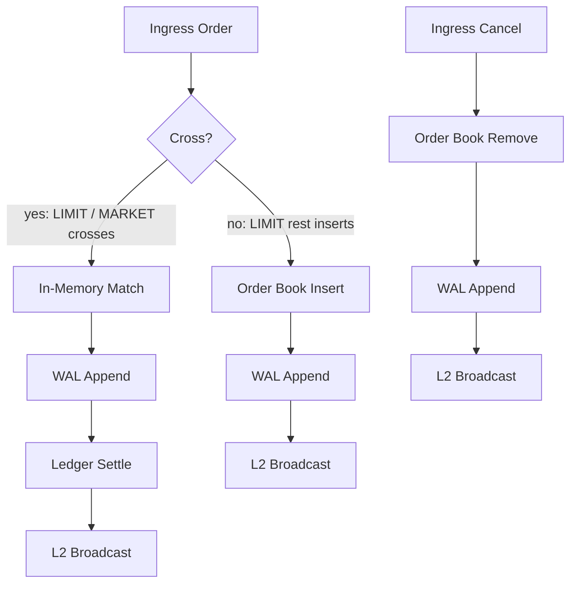

# orderbook-engine

**Motor de matching in-memory de alta performance, com WAL auditável e ledger de dupla entrada.**

> **Status (pt-BR):** implementado e verificado em 2026-10-21 pelas suítes `test-sprint-00` … `test-sprint-04`, incluindo `test-sprint-02-hardening` e `test-sprint-03-hardening`.
>
> **Performance:** baseline real de **127 ord/s** em 100.000 ordens (Intel Core i3-7100U, 4 threads, 2026-10-18). A meta de ≥50.000 ord/s **não foi atingida**; números completos e análise do gargalo em [`docs/PERFORMANCE.md`](./docs/PERFORMANCE.md).
>
> **Status (EN):** implemented and verified on 2026-10-21 by the `test-sprint-00` … `test-sprint-04` suites. Real baseline: **127 orders/sec** at 100k; the ≥50,000 orders/sec target was **not met** (see [`docs/PERFORMANCE.md`](./docs/PERFORMANCE.md)).

---

## Português (Brasil)

Motor de matching de ordens escrito em TypeScript, com o livro de ofertas inteiramente em memória. Cada comando (LIMIT, MARKET e CANCEL, com GTC/IOC) é casado em memória, persistido em um WAL append-only com event sourcing sobre SQLite e liquidado por um ledger de dupla entrada na mesma transação. O estado é reconstruído no boot por replay determinístico (snapshot ancorado + delta do WAL), e os dados de mercado L2 são publicados por streaming SSE.

### Por que para o mercado brasileiro?

- **Matching in-memory com prioridade preço-tempo:** melhor preço e cancelamento em O(1) (ponteiros para os extremos e índice `orderId → nó`); filas FIFO por nível em O(1); inserção de nível com busca binária em O(log N) no array ordenado de preços (o deslocamento do array é O(L) ao criar ou remover o nível).
- **Ledger de dupla entrada com garantias ACID:** uma transação SQLite por comando, com rollback total (SQL e estado em RAM), invariante Σ débitos = Σ créditos por transação e por asset, e imutabilidade por triggers que abortam `UPDATE`/`DELETE` em `journal_entries` e `settled_trades`.
- **WAL com hash chain SHA-256 por evento e snapshot ancorado** (`state_hash` + `wal_anchor_hash`): trilha de auditoria verificável no replay — base para auditoria e integração regulatória brasileira. O projeto **não** alega certificação regulatória.
- **Ativos configuráveis por string, incluindo BRL:** base e quote são definidos na configuração do `SettlementLedger`. Os fixtures e testes atuais usam BTC/USD.

### Quick start

```bash
npm install
npm run dev                          # Next.js em localhost
npm test                             # 7 suítes de validação (00 … 04 + hardening)
npm run bench -- --orders 100000     # benchmark standalone (GC exposto pelo script)
```

Requer Node.js 22 (versão usada no CI). A base SQLite é local e o servidor faz bind em `127.0.0.1` por padrão.

### Documentação

- [`docs/ARCHITECTURE.md`](./docs/ARCHITECTURE.md) — arquitetura, complexidade, WAL/event sourcing, ledger e streaming.
- [`docs/SECURITY.md`](./docs/SECURITY.md) — integridade do WAL, determinismo, validação e hardening.
- [`docs/PERFORMANCE.md`](./docs/PERFORMANCE.md) — baseline real e análise do gargalo.

---

## English

### Overview

An in-memory order matching engine built in TypeScript with strict price-time priority. LIMIT, MARKET and CANCEL orders (GTC/IOC) are matched in memory, persisted to an append-only WAL using event sourcing over SQLite (`better-sqlite3`) in the same transaction as the double-entry settlement, and replayed deterministically on boot from an anchored snapshot plus the WAL delta. L2 market data (depth snapshot, depth updates and trades) is published over SSE. The repository also ships a standalone benchmark suite.

### Event flow



**Legend**

| Branch | Events written to the WAL |
|---|---|
| Cross (`Ingress Order → In-Memory Match → WAL Append → Ledger Settle → L2 Broadcast`) | `ORDER_NEW` + one `TRADE_MATCH` per trade |
| No cross (`Ingress Order → Order Book Insert → WAL Append → L2 Broadcast`) | `ORDER_NEW` (resting order) |
| Cancel (`Ingress Cancel → Order Book Remove → WAL Append → L2 Broadcast`) | `ORDER_CANCEL` |

---

### Benchmark targets vs real baseline

Measured on 2026-10-18 (Intel Core i3-7100U, 4 threads, Node 24.12.0, better-sqlite3 12.11.1). Methodology and bottleneck analysis: [`docs/PERFORMANCE.md`](./docs/PERFORMANCE.md).

| Metric | Target | Measured | Verdict |
|---|---|---|---|
| Throughput | ≥ 50,000 orders/sec | 127 orders/sec @100k · 174 orders/sec @20k | ❌ Not met |
| Match latency p99 | ≤ 2 ms | 17.172 ms @100k · 12.575 ms @20k (end-to-end; matching not isolated) | ❌ Not certifiable |
| L2 broadcast latency p99 | ≤ 10 ms | not measured | ⚠️ Not verified |
| State replay (1M events) | ≤ 30 s | not measured | ⚠️ Not verified |

---

### Tech stack

Versions are declared in `package.json` (caret ranges).

| Piece | Version | Purpose |
|---|---|---|
| Next.js | ^16.0.0 (App Router) | Application server, API and streaming routes |
| React / React DOM | ^19.2.0 | Dashboard UI (Next.js peer) |
| TypeScript | ^5.9.0 (`strict`) | Language and strict type checking |
| Tailwind CSS | ^4.0.0 (`@tailwindcss/postcss`) | Dashboard styling |
| better-sqlite3 | ^12.0.0 (`@types/better-sqlite3` ^7.6.11) | WAL/event store, snapshots and ledger on SQLite |
| tsx | ^4.19.0 | Standalone engine and benchmark execution |
| ESLint | ^9.0.0 (flat config, `eslint-config-next` ^16.0.0) | Linting |
| Node.js | 22 (CI runtime) | Runtime |

Declared in `package.json` but not imported by `src/` at this commit: `drizzle-orm` ^0.44.0 and `zod` ^4.0.0. The storage layer talks to SQLite directly through `better-sqlite3`.

---

### Repository structure

```text
orderbook-engine/
├── package.json
├── package-lock.json
├── tsconfig.json                # strict, noEmit, @/* → src/*
├── next.config.ts               # serverExternalPackages: ["better-sqlite3"]
├── eslint.config.mjs            # ESLint 9 flat config
├── postcss.config.mjs
├── bench-results.json           # local benchmark output (gitignored)
├── .github/workflows/ci.yml     # CI pipeline
├── scripts/
│   ├── benchmark.mjs            # standalone benchmark entrypoint
│   └── test-sprint-*.mjs        # 7 validation suites (00…04 + 02/03 hardening)
├── docs/
│   ├── ARCHITECTURE.md
│   ├── PERFORMANCE.md
│   ├── SECURITY.md
│   └── testing/                 # reserved for per-cycle test instructions
├── sprints/
│   ├── README.md
│   ├── orderbook-engine.code-workspace
│   └── SPRINT_00 … SPRINT_05 (6 spec files)
└── src/
    ├── core/                    # price levels, FIFO queues, domain types
    ├── engine/                  # matching engine + atomic execution pipeline
    ├── storage/                 # SQLite schema, WAL hash chain, snapshots, replay
    ├── ledger/                  # accounts + double-entry settlement
    ├── api/                     # BigInt-safe DTOs, L2 depth, SSE server
    └── app/                     # Next.js App Router
```

---

### Scripts

| Script | Command | Description |
|---|---|---|
| `dev` | `next dev` | Development server on `localhost`. |
| `build` | `next build` | Production build of the App Router. |
| `start` | `next start` | Serves the production build; binds to localhost by default. |
| `lint` | `eslint .` | Project linting with ESLint 9 (Next 16 flat config). |
| `tsc` | `tsc --noEmit` | Strict type check, no emit. |
| `test` | `npm test` | Chains the 7 validation suites: `test-sprint-00`, `01`, `02`, `02-hardening`, `03`, `03-hardening` and `04`. |
| `bench` | `node --expose-gc scripts/benchmark.mjs` | Standalone benchmark. Flags: `--orders` (default 100,000) and `--users` (default 10,000). Writes `bench-results.json`. |

---

### Roadmap

Authoritative sprint specs: [`sprints/README.md`](./sprints/README.md).

| Sprint | Focus | Status |
|---|---|---|
| SPRINT_00 | Setup and core data structures (price levels, FIFO queues, sequence) | Implemented and verified |
| SPRINT_01 | Matching engine core: price-time priority for LIMIT / MARKET / CANCEL with GTC/IOC | Implemented and verified |
| SPRINT_02 | WAL persistence and deterministic replay (+ 02.5 hash chain and snapshot hardening) | Implemented and verified |
| SPRINT_03 | Double-entry settlement ledger (+ 03.5 snapshot anchoring and pipeline atomicity) | Implemented and verified |
| SPRINT_04 | L2 orderbook streaming API (SSE snapshot + deltas + trades) | Implemented and verified |
| SPRINT_05 | Benchmark suite, polish and CI | Benchmark implemented; performance targets not met; CI performance gate not implemented |

### Documentation

- [`docs/ARCHITECTURE.md`](./docs/ARCHITECTURE.md) — architecture, complexity analysis, WAL/event sourcing, ledger and streaming.
- [`docs/SECURITY.md`](./docs/SECURITY.md) — WAL integrity, determinism, validation, local isolation and ledger hardening.
- [`docs/PERFORMANCE.md`](./docs/PERFORMANCE.md) — real baseline, bottleneck analysis and CI gate status.
- [`sprints/README.md`](./sprints/README.md) — sprint roadmap and specifications.
