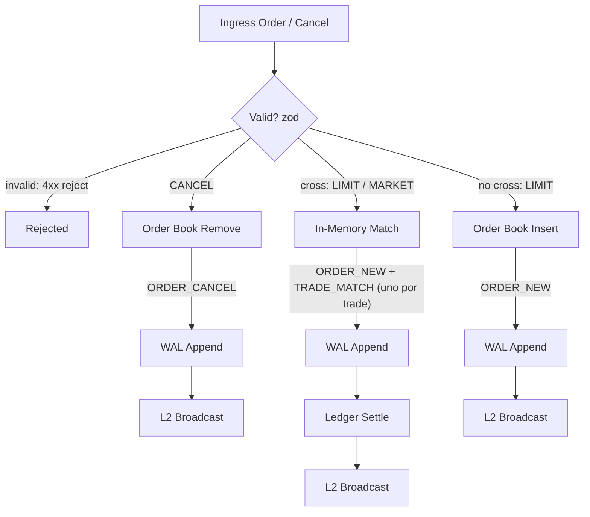
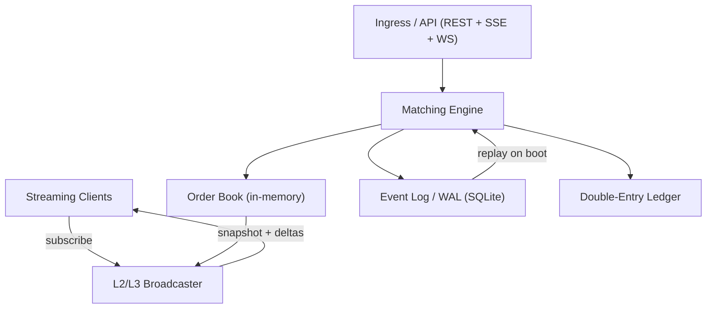

# Arquitectura — High-Throughput In-Memory Orderbook & Matching Engine

> **Estado del documento:** implementado y verificado (2026-10-21) por las suites `test-sprint-00` … `test-sprint-04`, incluidos los hardening `test-sprint-02-hardening` (hash chain) y `test-sprint-03-hardening` (anclaje de snapshots y atomicidad del ledger). Este documento describe el comportamiento real del código. El modelo de amenazas e integridad está en [`docs/SECURITY.md`](./SECURITY.md) y la baseline empírica de rendimiento en [`docs/PERFORMANCE.md`](./PERFORMANCE.md).

## 1. Visión general

El motor mantiene el libro de órdenes **íntegramente en memoria** y usa SQLite únicamente como log de eventos (WAL/Event Sourcing) y como almacén del ledger de liquidación. La reconstrucción del estado es determinista: en el arranque se re-ejecuta el log de eventos desde el último snapshot, sin depender de caches ni de bases de datos que reproduzcan el estado "caliente".

### Principios de diseño

1. **In-memory-first** — el libro de órdenes vive en memoria para cumplir los objetivos de latencia (p99 ≤ 2 ms). SQLite nunca está en el hot path del matching; el log se escribe dentro de la misma transacción de cada comando.
2. **Determinismo** — dado un log de eventos íntegro, el replay produce exactamente el mismo estado en cualquier máquina y en cualquier momento. Prohibido `Date.now()`/`Math.random()` dentro del payload de eventos; la única fuente de orden es un `sequence` monotónico.
3. **Event sourcing** — el WAL es la fuente de verdad. El estado en memoria es una proyección derivable del log. Toda mutación se modela como un evento append-only.
4. **Prioridad Precio-Tiempo** — un match primero elige el mejor precio y, dentro del nivel, la orden más antigua (menor `sequence`). El tiempo de reloj nunca decide la prioridad; solo la decide el `sequence` monotónico.

## 2. Flujo de eventos

Cada comando (orden o cancelación) es **una transacción SQLite**: los eventos se escriben en el log y los movimientos del ledger se aplican dentro del mismo `BEGIN IMMEDIATE ... COMMIT`. El broadcast L2 ocurre solo después del commit, por lo que ningún consumidor observa estado no persistido. El WAL solo registra los tres tipos de §4.1: `ORDER_NEW` (ingreso), un `TRADE_MATCH` por trade y `ORDER_CANCEL` (cancelación). La retención de fondos (`holdFunds`) y la liquidación (`settleTrade`) son movimientos del ledger dentro de esa misma transacción, no eventos del log (ver §5).

## 3. Análisis de complejidad (foco del documento)

### 3.1 Cotas por operación

| Operación | Complejidad | Mecanismo |
|---|---|---|
| Mejor precio (best bid / best ask) | **O(1)** | Punteros directos a los extremos del árbol de niveles (mínimo ask, máximo bid). |
| Localizar / insertar / eliminar nivel de precio | **O(log N)** | Árbol balanceado (AVL/red-black) o skiplist ordenados por precio. |
| Encolar / desencolar orden dentro de un nivel | **O(1)** | Cola FIFO por nivel con punteros `head`/`tail`. |
| Cancelar orden en mitad de cola | **O(1)** | Hash `orderId → (nivel, nodo)` + lista doblemente enlazada para desenlazar sin recorrer. |
| Barrer niveles para una orden MARKET | O(K log N) con K = niveles tocados | Iterador ordenado del árbol/skiplist; K niveles se recorren en O(K) amortizado. |
| Snapshot L2 (top-K niveles) | O(K) | Iteración ordenada ascendente/descendente desde los extremos. |
| Replay de E eventos | O(E) | Lectura secuencial del log; cada evento se aplica en O(log N) u O(1) según su tipo. |

### 3.2 Comparativa de estructuras para niveles de precio

| Criterio | BTreeMap (AVL/red-black) | SkipList | Map (hash) + BinaryHeap |
|---|---|---|---|
| Best bid/ask | O(1) con punteros a extremos | O(1) con punteros a extremos | O(1) al top del heap (solo un lado por heap); retirar el top cuesta O(log N) |
| Insertar nivel | O(log N) peor caso | O(log N) esperado | O(log N) en heap, O(1) en map |
| Eliminar nivel arbitrario | O(log N) | O(log N) | ❌ heap no soporta delete sin búsqueda lineal O(N) |
| Predecesor / sucesor de precio | O(log N), u O(1) con enlaces enlazados | **O(1)** vía enlaces horizontales | ❌ no soportado |
| Iteración ordenada (snapshot L2, barridos) | O(N) | O(N) | ❌ el hash no preserva orden; el heap solo entrega orden extrayendo |
| Determinismo | Totalmente determinista | Aleatorio solo al construir niveles (se puede sembrar o fijar) | Determinista |
| Implementación en TS | Propia (~300 líneas, rotaciones) | Propia (~150 líneas) | Nativa (Map + array) |

**Opción recomendada: SkipList para niveles de precio** (BTreeMap/AVL como alternativa equivalente si se exige peor caso garantizado):

- Cumple O(log N) para insertar/eliminar nivel y **O(1) para predecesor/sucesor de precio**, operación crítica para el barrido de market orders y para la reconciliación de profundidad.
- Su implementación es sustancialmente más simple que un AVL/red-black y su costo esperado es igualmente logarítmico; con niveles sembrados no introduce aleatoriedad en el estado.
- El determinismo no se ve comprometido: la estructura de niveles solo depende de la secuencia de precios insertados, que a su vez depende únicamente de los eventos.

**Por qué `Map` (hash) no sirve para predecesor/sucesor:** un hash no mantiene orden total de claves. Para calzar hay que responder *"¿qué nivel cruza el precio entrante?"* y *"¿cuál es el siguiente mejor nivel tras vaciar este?"*; un `Map` exige recorrer todas las claves o mantener una segunda estructura ordenada duplicada. La combinación `Map + BinaryHeap` además no permite eliminar niveles arbitrarios de forma eficiente (necesario al vaciarse un nivel por match o cancelación).

### 3.3 Garantía Precio-Tiempo con `sequence`

- Cada orden recibe un **`sequence` monotónico** (entero, asignado por el motor en un solo hilo, sin huecos ni reutilización) en el momento de su aceptación.
- La prioridad es estrictamente **precio → sequence**: dentro de un nivel (mismo precio), las colas FIFO atienden siempre al `head` (menor `sequence`).
- Al no usar relojes, dos órdenes no pueden "empatar" de forma ambigua: el orden de llegada al motor coincide con el orden de asignación de `sequence`.
- El motor es **single-threaded** (un event loop): la asignación de `sequence` y la mutación del libro nunca compiten, lo que hace el determinismo trivial de razonar.

## 4. WAL & Event Sourcing

> Desambiguación: "WAL" aquí es el **log de eventos del dominio** (append-only). No confundir con el `journal_mode=WAL` de SQLite, que es una configuración del propio SQLite (también habilitada).

### 4.1 Formato de eventos

Los eventos se persisten en la tabla `events_log` (esquema en `src/storage/db.ts`) y solo se escriben mediante `INSERT`. **No existen triggers anti-`UPDATE`/`DELETE` en `events_log`**: la manipulación directa se detecta por la hash chain al hacer replay (§4.2).

| Campo | Tipo | Nota |
|---|---|---|
| `sequence` | `BIGINT PRIMARY KEY` | Secuencia monotónica global asignada por `WalLogger` (sin `AUTOINCREMENT`). |
| `event_type` | `TEXT NOT NULL` | `ORDER_NEW`, `ORDER_CANCEL`, `TRADE_MATCH`. Sin `CHECK`: el replay rechaza cualquier otro valor con `UnknownEventTypeError`. |
| `payload` | `TEXT NOT NULL` | JSON serializado de forma determinista (bigint → string; claves bigint del dominio acotadas). |
| `prev_hash` | `TEXT NOT NULL` | Hash SHA-256 de la fila anterior; default `GENESIS_HASH` (64 ceros hexadecimales). |
| `hash` | `TEXT NOT NULL` | SHA-256 de esta fila (preimagen en §4.2); las filas legacy quedan con `''`. |
| `created_at` | `INTEGER NOT NULL` | `DEFAULT (unixepoch() * 1000)` aplicado por SQLite; metadato logístico que **no** participa en la reconstrucción del estado. |

### 4.2 Append-only con hash chain SHA-256

- **Preimagen canónica:** `hash = SHA256(sequence|prev_hash|event_type|payload)`. `WalLogger` la calcula con `computeEventHash` y `replayState` la recalcula con `writeEventHashInput`, el punto único de verdad del formato. El `payload` entra **exactamente** como el string JSON persistido (serialización determinista, bigint → string).
- **Génesis:** el primer evento de un WAL vacío enlaza con `GENESIS_HASH` (64 ceros hexadecimales).
- **Filas legacy:** un `hash` vacío (`''`, filas anteriores a Sprint 02.5) se trata como cadena rota — fail-closed; nunca se acepta silenciosamente.
- **Detección de tamper:** modificar `payload`, `event_type`, `sequence` o `hash` rompe la cadena y el replay lanza `WalCorruptionError` (`kind: "prev_hash"` o `kind: "hash"`) con la secuencia exacta de la fila ofensora. La restauración **aborta**; no se repara in-place ni se reescribe historia.
- **No implementado:** no hay checksum por segmento ni archivos de segmento; el único checksum es la hash chain por evento.

### 4.3 Snapshot anclado y recuperación

- El snapshot congela el libro (`bids`/`asks` y órdenes vivas en orden Price-Time) y el `matchCounter`; el histórico de trades no se congela (su fuente de verdad es el WAL/ledger). `takeSnapshot` se invoca explícitamente y persiste en la tabla `snapshots` (`src/storage/snapshot.ts`).
- **Integridad:** cada snapshot guarda `state_hash = SHA256(wal_anchor_hash + last_sequence + state_data)` y `wal_anchor_hash` (el `hash` SHA-256 de la fila `events_log.last_sequence` cubierta).
- **Verificación antes de restaurar:** el replay recalcula `state_hash`; una discrepancia lanza `SnapshotCorruptionError` y aborta. Si el `wal_anchor_hash` no coincide con el hash real de la fila en el WAL (o la fila no existe), lanza `SnapshotAnchorMismatchError`, descarta el snapshot y fuerza replay limpio desde el evento 0.
- **Retención:** `MAX_SNAPSHOTS = 3`; cada nuevo snapshot elimina los más antiguos por `last_sequence` y `created_at`.
- Replay con snapshot = restaurar el estado + re-aplicar los eventos con `sequence > last_sequence`.
- **No implementado (roadmap):** no hay compaction ni archivado/eliminación de eventos anteriores al snapshot; `events_log` crece indefinidamente más allá de la retención de snapshots.

### 4.4 Replay determinista en arranque

- El replay re-ejecuta el log en orden estricto de `sequence` y reconstruye el estado del **libro** (bids/asks, índice de cancelación y `matchCounter`). No re-aplica asientos del ledger ni re-emite eventos: `TRADE_MATCH` se audita en la cadena pero no se re-ejecuta, porque los trades se regeneran al re-aplicar los `ORDER_NEW`.
- Reglas de oro:
  - **Prohibido `Date.now()` o `Math.random()` dentro del payload de eventos** o de cualquier cálculo que afecte el estado reconstruido.
  - `matchId` monotónico del motor (`match-1`, `match-2`, …) derivado del `matchCounter`, que el snapshot restaura para evitar colisiones; los `orderId` los aporta el caller.
  - Precios y cantidades en **enteros de escala fija** (nunca `number` con punto flotante para dinero).
  - **Verificación real:** auditoría incondicional de la hash chain fila a fila durante el replay (aborta con error tipado) y comparación canónica bit a bit del estado reconstruido contra el estado de control en las suites de hardening, no un hash de estado calculado post-replay.

### 4.5 Transacciones SQLite

- Un comando = una transacción (`BEGIN IMMEDIATE`): inserción de los eventos del comando + aplicación de movimientos del ledger + `COMMIT`. Cualquier fallo → `ROLLBACK` total, sin efectos parciales observables.
- Los snapshots quedan **fuera** del pipeline del comando: `takeSnapshot` se invoca de forma explícita con la última `sequence` ya persistida y escribe en la tabla `snapshots`; no hay creación implícita de snapshots por orden ni por cancelación.
- `journal_mode=WAL` y `synchronous=NORMAL` para durabilidad y concurrencia razonables sin bloquear el motor.

## 5. Ledger de doble entrada

- **Invariante:** por cada transacción (`tx_id`) y asset, Σ débitos = Σ créditos. `SettlementLedger.audit()` lo verifica sobre `journal_entries` y además compara el neto del journal contra los saldos en memoria: `unbalancedTransactions` y `memoryMismatches` deben ser 0.
- **Saldos en memoria:** el `SettlementLedger` mantiene `userId → asset → account_type` en `Map` con `bigint`. Fondos insuficientes, montos ≤ 0 o un release excesivo lanzan `BalanceOverflowError` antes de persistir; un descuadre lanza `UnbalancedTransactionError`. **No existe tabla `accounts` ni `CHECK (balance >= 0)`** en SQLite.
- **Retención antes del match:** `holdFunds` mueve AVAILABLE → LOCKED al aceptar la orden; el taker retiene antes de calzar. Sin retención completa la orden se rechaza.
- **Liquidación atómica:** `settleTrade` registra los asientos Maker/Taker de base y quote (con comisiones opcionales a `FEE_VAULT`) en `journal_entries`, dentro de la misma transacción SQLite que el WAL y el calce.
- **Rollback ante fallo parcial:** una excepción revierte la transacción SQL completa y el `ExecutionPipeline` restaura motor, ledger y logger desde la captura previa: no quedan débitos sin crédito ni secuencias consumidas.
- **Red de seguridad en SQLite** (detalle en `docs/SECURITY.md` §7): `CHECK (account_type IN ('AVAILABLE','LOCKED','FEE_VAULT'))`, `CHECK (side IN ('DEBIT','CREDIT'))` y `CHECK (amount > 0)` en `journal_entries`; PK de `settled_trades.match_id` (impide liquidar dos veces el mismo match); triggers `BEFORE UPDATE`/`BEFORE DELETE` con `RAISE(ABORT)` en `journal_entries` y `settled_trades`. Esos triggers **no** aplican a `events_log`.

## 6. Streaming L2/L3

### 6.1 Modelo

- **L2** — libro agregado por nivel: snapshot inicial + deltas por nivel (insert/update/remove con cantidades).
- **L3** — orden por orden: eventos individuales de colocación, match y cancelación.
- Ambos canales emiten un `seq` de stream monotónico que permite a los clientes detectar huecos y re-sincronizarse.

### 6.2 SSE vs WebSocket

| Criterio | SSE | WebSocket |
|---|---|---|
| Dirección | Solo servidor → cliente | Bidireccional |
| Reconexión | Nativa (Last-Event-ID, auto-retry del navegador) | Manual (protocolo propio) |
| Overhead por frame | Bajo sobre HTTP/2 | Bajo; frames binarios |
| Integración Next.js 16 | Nativa (Route Handler con ReadableStream) | Requiere servidor WebSocket adicional |
| Carga de conexiones | Muy alta, multiplexada | Alta, pero más estado por conexión |
| Caso ideal | L2/L3 read-only, dashboards | L3 con envío de órdenes por el mismo canal |

**Recomendación:** SSE como canal primario para L2 y L3 (read-only, reconexión nativa, integración directa en Next.js 16). WebSocket se incorpora solo si un sprint posterior exige envío de órdenes por el canal de streaming o latencia de frame inferior en conexiones con keep-alive agresivo. El objetivo de broadcast p99 ≤ 10 ms aplica a ambos canales.

### 6.3 Reconciliación de profundidad

- Cada delta lleva `seq`; si un cliente detecta un hueco (`seq` faltante), se re-suscribe: recibe snapshot + deltas desde el `seq` anterior.
- Heartbeat periódico con el `seq` actual para detectar desconexiones silenciosas.

### 6.4 Backpressure

- El broadcaster **nunca bloquea el motor de matching**: encola en buffers acotados por suscriptor.
- Políticas por conexión lenta: coalescing de deltas del mismo nivel (solo el último cuenta) y, de persistir, desconexión del consumidor con código de "re-suscríbete" (drop-slowest, nunca drop del motor).
- Límites de conexiones y tasas por IP documentados en `docs/SECURITY.md`.

## 7. Diagrama de componentes

## 8. Decisiones técnicas

1. **Motor standalone importable** tanto por Next.js (rutas de ingress) como por `tsx` (benchmarks y herramientas de replay). El core no depende de `next` ni de `next/headers`.
2. **Single-threaded event loop** para el motor: determinismo trivial, sin locks, sin carreras en el `sequence`.
3. **SkipList (alternativa AVL/red-black)** para niveles de precio; colas FIFO con `head`/`tail` y hash `orderId → nodo` por nivel.
4. **Enteros de escala fija** para precios/cantidades; zod normaliza y valida en el límite.
5. **Transacción por comando** (WAL + ledger + match) en SQLite con `journal_mode=WAL`; cliente singleton en `globalThis` y `serverExternalPackages: ['better-sqlite3']` en `next.config` (patrón validado para Next.js + better-sqlite3).
6. **SSE primario, WebSocket opcional** para streaming L2/L3 (ver §6.2).
7. **Bind a `localhost` por defecto** en todos los modos (dev, start, bench sin red).

## 9. Riesgos abiertos

| Riesgo | Mitigación propuesta | Estado |
|---|---|---|
| GC pauses de Node afectan el p99 ≤ 2 ms | Objetos pre-asignados en el hot path, medición con `--expose-gc`, benchmark que lo detecte | Abierto (SPRINT_05) |
| Next.js dev vs motor de producción difieren en rendimiento | Benchmarks siempre contra el motor standalone vía `tsx`; Next solo como frontera | Abierto (SPRINT_05) |
| Replay de 1M eventos > 30 s | Snapshot + replay incremental; benchmark de replay en SPRINT_05 | Abierto |
| Precisión monetaria con `number` | Enteros de escala fija decididos; pendiente definir escala exacta por mercado | Decidido en principio, escala por fijar |
| Límites de profundidad L2 y tamaño de snapshot | Política de top-K y tamaño máximo por fijar en SPRINT_04 | Abierto |
| Crecimiento del log entre compactions | Umbrales de compactación por número de eventos y por tamaño | Abierto (SPRINT_02) |
| Seguridad del streaming en modo local | Sin autenticación en localhost; añadir tokens solo si se expone fuera | Ver `docs/SECURITY.md` |
